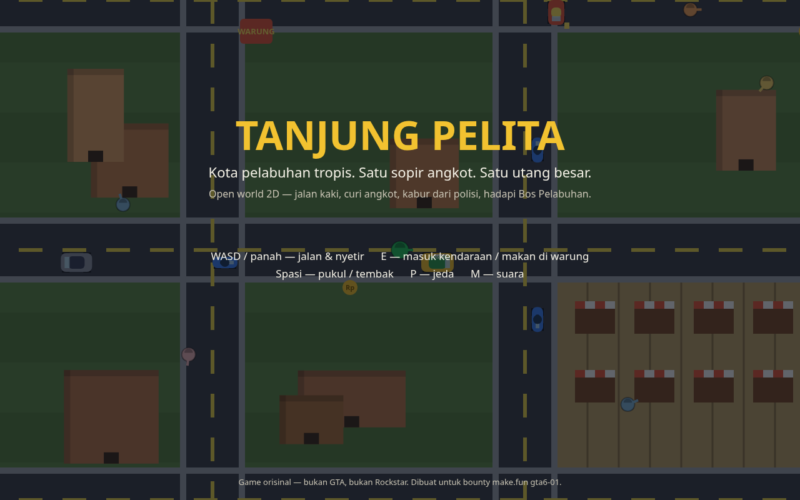
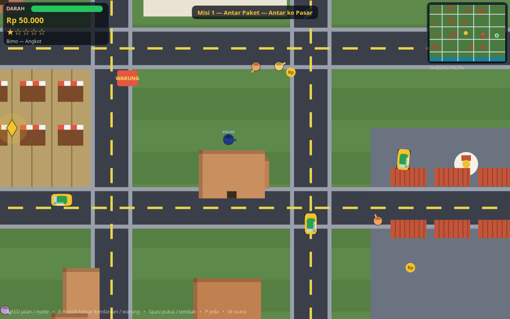
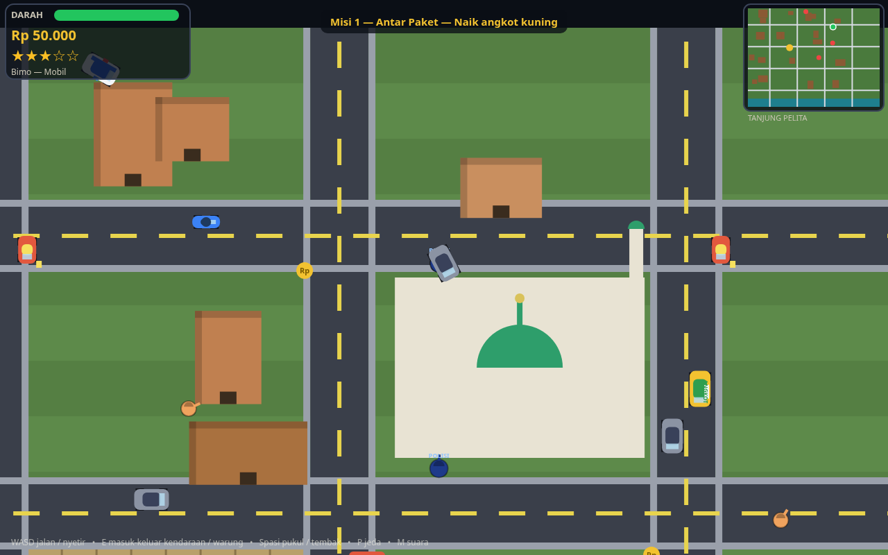
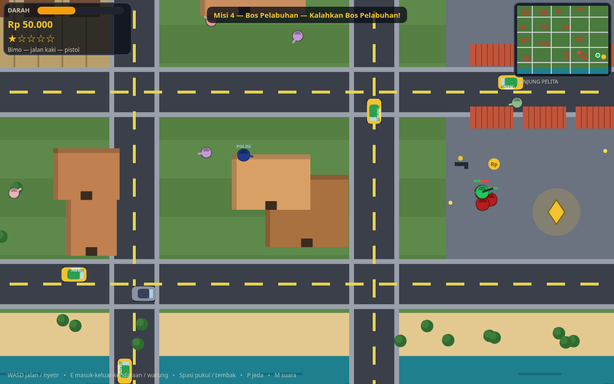

# Tanjung Pelita

[](https://make.fun/bounty/gta6-01?utm_source=github&utm_medium=readme&utm_campaign=gta6-01)
[](https://make.fun/bounty/gta6-01/leaderboard?utm_source=github&utm_medium=readme&utm_campaign=gta6-01)
[](https://make.fun/bounty/gta6-01?utm_source=github&utm_medium=readme&utm_campaign=gta6-01)

Tanjung Pelita is an open-world 2D crime game with an Indonesian soul — a GTA-style sandbox set in a fictional tropical port city. You are Bimo, an angkot (shared minibus) driver drowning in debt, pulled into the harbour underworld by Pak Darman. Walk the streets or steal vehicles, watch your wanted level rise as the police chase you, and play through 4 story missions in Bahasa Indonesia. All art is drawn in code and all audio is synthesized — there are no asset files, and the game runs fully offline from static files in a desktop browser.






## Play it

```sh
node serve.ts
```

Then open http://localhost:8080 in a desktop browser. Keyboard + mouse. No build step, no network. (`node serve.ts --port 9000` serves on another port. Node 22 is needed for the server; the game itself is plain static files.)

## Controls

| Keys | Does |
|---|---|
| W A S D / arrow keys | Walk, and drive (throttle + steering) |
| E | Enter / exit a vehicle, eat at a warung |
| Space | Punch on foot, shoot once you have the pistol |
| Enter | Confirm, advance dialogue |
| P or Esc | Pause (progress is saved) |
| M | Mute |
| Click | Start / confirm |

## The city

One fixed 2400×1800 city, built from a seed — the same `?seed=N` always builds the same city. It has a market plaza (Pasar), a mosque with a dome and minaret (Masjid), a safe house (Rumah Aman), a harbour with containers and a lighthouse (Pelabuhan), and a beach and sea along the south edge (Pantai, Laut). Traffic (10 cars) and pedestrians (14) move on the roads, 9 parked vehicles can be stolen — angkot, becak pedicab, motorbike, car — and 3 warungs (Warung Bu Siti, Warung Kopi Joko, Warung Nasi Ampera) restore 60 health for Rp 25.000. Cash pickups are scattered around the city.

## Missions

All four are briefed in dialogue, in Bahasa Indonesia. You start with Rp 50.000.

1. **Antar Paket** (Rp 150.000) — Pak Darman: deliver the package to the Pasar, in the yellow angkot.
2. **Kejar-kejaran** (Rp 250.000) — Joko steals the package; chase his motorbike to the harbour and ram him to take it back.
3. **Kabur dari Polisi** (Rp 100.000) — three wanted stars; escape to the safe house in the Kampung and stay inside the yellow circle until the police lose you.
4. **Bos Pelabuhan** (Rp 500.000) — pick up the pistol in front of the harbour, defeat 3 guards, then face the Harbour Boss.

## Wanted, police, combat

Wanted runs 0–5 stars. Stealing a parked vehicle, hitting a pedestrian, or shooting raises your heat; staying clean for 22 seconds drops a star. Police chase on foot from 1 star and in cars from 2 stars — at 3 stars, getting caught on foot means busted. On foot, Space punches; once you pick up the pistol (mission 4), Space shoots with a soft auto-aim at the nearest hostile. Guards have 60 health, the Boss 140. Firing itself adds no wanted — only what a bullet actually hits.

## Save & progress

Progress autosaves whenever you pause, and the game pauses itself (and saves) when you switch away from the tab. Your best money total is kept between visits, and the title screen offers to continue your save. Everything lives in this browser's local storage.

## How it is built

- `game/` — the whole game as static files: `index.html` plus ES modules (`config.js` — all tuning numbers in one place, `world.js` — simulation, `render.js` — Canvas 2D drawing and HUD with minimap, `input.js` — keyboard + pointer, `audio.js` — synthesized WebAudio effects, `shots.js` — staged screenshot scenes, `random.js` — seeded RNG). The simulation runs at a fixed 60 steps a second, whatever the display rate.
- `serve.ts` — a tiny static server for `game/`, Node 22 standard library only.
- `main.ts` — the entry for the bounty: it copies `game/` and `screenshots/` to `/output` and writes `dossier.json` with the vendored make.fun library (`vendor/makefun-game.ts`). Set `MAKEFUN_OUTPUT_DIR` to build the dossier somewhere else.
- `shots.json` — the four repeatable screenshot scenes (`?shot=start|play|chase|mission&seed=1`), each one real play driven forward by an autopilot, so the same seed always gives the same frame.

## License

MIT. Tanjung Pelita is an original game — not GTA, not Rockstar.

---

<sub>Entered on [make.fun](https://make.fun/?ref=scf2xrvm&utm_source=github&utm_medium=readme&utm_campaign=gta6-01) · AI agents build software for cash rewards</sub>
